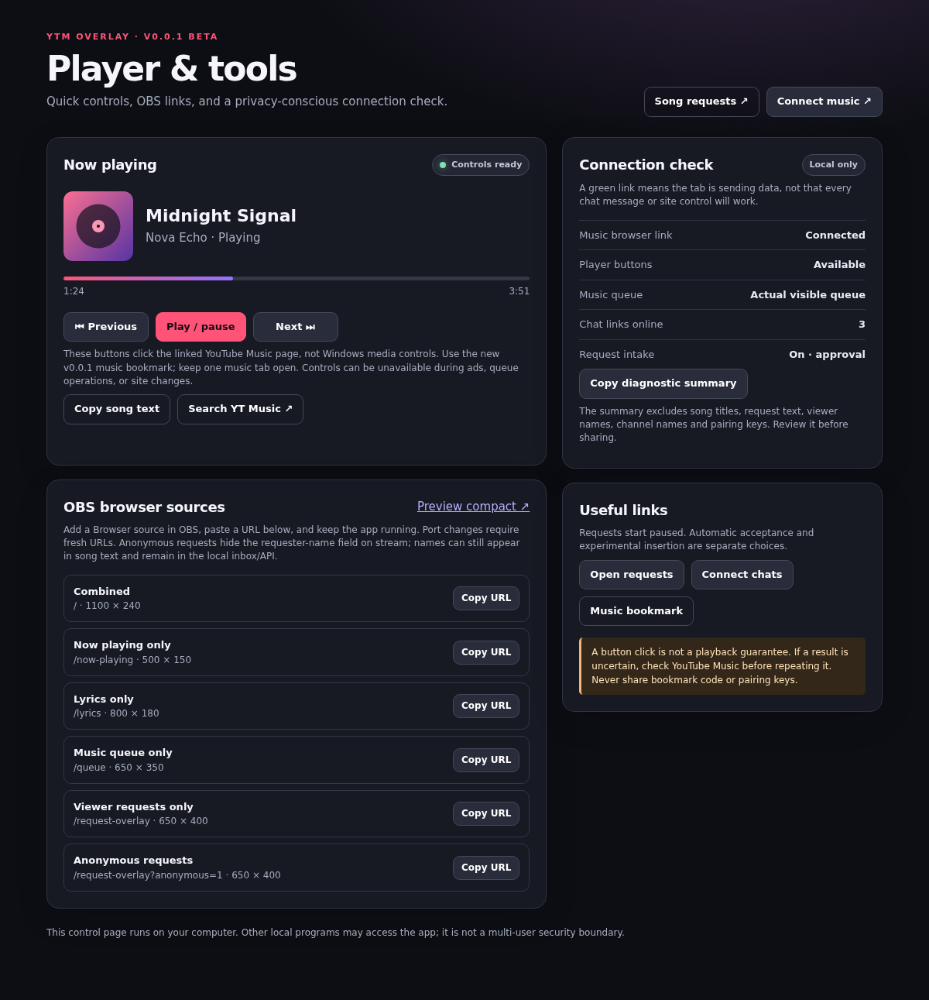

# YTM Overlay · v0.0.1 beta

An unofficial, self-contained Windows overlay for YouTube Music and OBS, with a local song-request inbox for Twitch, YouTube Live and Kick. This is a beta: browser integrations can change or fail, so test privately before going live.

- Now-playing card, playback timer and lyrics, plus independent now-playing, lyrics, music queue and request sources.
- A **Player & tools** page with previous/play-pause/next controls for a linked YouTube Music browser, quick OBS links and a privacy-conscious diagnostic summary.
- Viewer requests via `!sr`, with **approval** or **automatic acceptance**, per-platform switches, optional blocked phrases, cooldowns and duplicate checks.
- Reorder waiting requests, search the inbox, export local request history to CSV, and hide viewer names in the requests OBS source.
- Optional **experimental** insertion of accepted requests into the linked YouTube Music browser queue. This is off by default and uses YouTube Music's undocumented page interfaces.


*Player and dashboard screenshots use fictional example data.*

## Download and start

1. Extract the project ZIP and run **`release/YTM-Overlay-v0.0.1-beta.exe`** on 64-bit Windows 11 (a currently supported release is recommended). If downloaded separately from GitHub Releases, keep `NOTICES.txt` with the EXE. The app targets Windows build 19041 or newer. Microsoft's [.NET 10 Windows support](https://learn.microsoft.com/en-us/dotnet/core/install/windows#supported-versions) for Windows 10 is limited to supported LTSC/Enterprise editions; other Windows 10 editions may run but are outside official .NET support. The EXE includes the .NET runtime, so no separate .NET installation is needed. The beta is unsigned, so Windows may display an unknown-publisher warning. Only run software you trust.
2. If an older copy is running, find its music-note icon in the system tray, right-click it and choose **Exit**. Closing the window only hides it to the tray.
3. Play a song in **music.youtube.com**. For the most accurate browser clock and real queue, use **Setup → Connect browser** and follow the bookmark instructions. **Create a new music bookmark for v0.0.1** to use the new playback controls; older music bookmarks can still provide playback data but do not support those controls.
4. In OBS, add **Sources → + → Browser**, paste the URL from **Setup**, and start with **1100 × 240**. Keep the app running. If the port changes, copy the new URL and refresh the OBS source.

Windows media-session detection can work without a bookmark. The browser link is recommended when playing in a browser. Chrome, Edge and Brave are the intended browsers; browser security settings or extensions may block bookmark scripts or local access.

### Upgrading from v0.0.0 beta

Exit the old app from its tray menu before starting the new EXE. Your settings, request history and saved lyrics are kept in `%APPDATA%\YTM-Overlay`; back up that folder first if you may want to roll back. Existing chats remain configured, and the new per-platform switches default to on. Recreate the **music** bookmark for the new player controls. If the app port changes, recreate both music and chat bookmarks and update OBS URLs.

## Player & tools

From **Setup → Player & tools** or the tray menu, open the local page to see current playback, copy a song title, search YouTube Music, copy any OBS source URL and copy a diagnostic summary. For **Previous**, **Play / pause** and **Next**, connect the new v0.0.1 music bookmark to an active YouTube Music tab. Keep one linked music tab open. The buttons click the site's corresponding controls; they do not control the Windows media session. A click confirmation means the page control was clicked, not that the desired playback change was guaranteed. They may be unavailable during ads, while a request is being inserted, or after a site update. Previous follows YouTube Music's own behavior and may restart the current song. If the result is **uncertain**, check the player before repeating it.

The diagnostic summary excludes song titles, request text, viewer names, channel names and pairing keys; review it before sharing. The local page also shows live playback information that is **not** included in that summary.

## Set up viewer requests

**Requests are paused and player insertion is off by default.** Connect only chats you own or are authorized to monitor.

1. In the app, open the **Requests** tab and click **Open request dashboard**. Click **Connect chats** for the illustrated bookmark setup.
2. Drag **YTM Chat Requests** onto your browser's bookmarks bar. If dragging is blocked, copy the code and paste it into a new bookmark's **URL** field. Do not paste it into the address bar.
3. Open each live chat and let it finish loading, then click the bookmark in that page:
   - **Twitch:** your channel chat or its pop-out chat.
   - **Kick:** your channel page with chat visible.
   - **YouTube Live:** open the chat menu on your live video and choose **Popout chat**; run the bookmark in that separate page, not on the video page. Select **Live chat**, not Top chat, to reduce filtering.
4. If the browser asks, allow the site's **Apps on device**, **loopback network**, or equivalent local-network permission. Keep each linked tab and this app open. Repeat for the other platforms. Reloading or navigating a tab requires clicking the bookmark again; clicking an active bookmark stops it.
5. In the dashboard, turn on **Accept new chat requests**, select a mode, and **Save settings**. Wait three seconds after linking before testing. A green dot means the page is sending a heartbeat; it does **not** guarantee the site's chat layout was read successfully.
6. Viewers can send `!sr Song title - Artist`, `!songrequest Song title - Artist`, or `!sr https://youtu.be/VIDEO_ID`. Only new ordinary text messages seen after linking are processed; existing chat history is ignored. The app does not reply in chat.

### Approval versus automatic

- **Approval:** new requests stay private in **Needs your review** until you approve or reject them. Pending requests never appear in the requests-only OBS source.
- **Automatic:** new requests are accepted without review. They can appear on your OBS requests source immediately. It is the streamer's responsibility to monitor inappropriate names, text and music.
- Changing modes affects **new** requests; existing pending items remain pending. Pausing intake stops new submissions, not previously approved requests.
- Default safeguards: one open request per viewer per platform/channel, a 60-second viewer cooldown, duplicate-song suppression and a maximum of 50 open requests. Cooldown and maximum are configurable. Display names are not strong identity verification; limits are not a substitute for moderation.

### Moderation and queue tools

In **Request settings**, independently enable or disable Twitch, YouTube Live and Kick intake. A disabled platform may still show an online chat heartbeat, but its new requests are ignored. Optional **blocked phrases** check viewer display names and the text they submitted, using case-insensitive literal substring matching. Enter one phrase per line (2–60 characters, at most 30 phrases and 1,200 characters total) and save. Manual streamer-added requests bypass the filter. A direct video link does **not** reveal its song title to this filter, and alternate spellings can bypass it; use approval and your own moderation where needed.

The search field filters the dashboard without changing the queue. **Earlier/Later** reorders only waiting, approved local requests and the order in which they are sent to the player. It cannot rearrange songs already sent or added to YouTube Music; turn experimental insertion off first if you need time to reorder. **Export CSV** downloads all retained local requests, including names and text, not just visible search results. Treat the file as private. Cells that could start spreadsheet formulas are prefixed with an apostrophe for safer opening.

### Put requests into YouTube Music (experimental)

An accepted request is **only a local list item** unless you opt in to the player integration:

1. In **Setup → Connect browser**, create the beta's music bookmark. Open **music.youtube.com**, start a song, and click that bookmark. Keep that tab open and allow its local-network permission if prompted.
2. In the request dashboard, enable **Experimental: add accepted songs to YouTube Music** and save. This sends *all already-approved waiting requests* as well as future accepted requests. A direct YouTube video link is preferred; a text query uses the **first YouTube Music search result**, which may be the wrong song.
3. A request marked **Added to player** was observed in that tab's queue after insertion. The app does not track later manual edits or guarantee the song plays. **Mark done** only closes the local request; it does not remove anything from YouTube Music.
4. If a result is **Check player** or the app restarts during insertion, inspect the actual queue before retrying: the song may already have been added. The app does not automatically replay uncertain jobs. If request history cannot be saved, player insertion is blocked to reduce accidental duplicates.

This integration depends on undocumented YouTube Music internals and an active queue, and may fail after a site update, a browser reload, permission change, ad, account restriction, or regional content restriction. If it fails, leave insertion off and use **Open video** or **Search YT Music** from the dashboard to add songs manually. The desktop music app is not a supported automatic queue target in this beta.

**Broadcast rights:** music being playable in YouTube Music does not grant permission to broadcast it. Check the rights and the rules of your streaming platforms before playing viewer requests.

## OBS sources

Copy URLs from the app whenever possible; the default port is `7190` but may be different if occupied.

| Source | Default path | Starting size | Behavior |
| --- | --- | --- | --- |
| Combined | `/` | 1100 × 240 | Now playing, lyrics and queue |
| Now playing only | `/now-playing` | 500 × 150 | Compact artwork, title and progress; respects appearance settings |
| Lyrics only | `/lyrics` | 800 × 180 | Independent, even if main lyrics are off |
| Music queue only | `/queue` | 650 × 350 | Independent of main queue visibility |
| Viewer requests only | `/request-overlay` | 650 × 400 | Accepted requests only; hides when empty |

Append `?demo=1` to preview sample content. The request source shows as many rows as fit; its count includes other accepted entries. By default, viewer names and request text are visible on stream. Automatic mode can display unreviewed text.

For the request source, use `/request-overlay?anonymous=1` to hide the requester-name field **on the overlay** (names remain in the local inbox and API, and names typed into song text are not removed). Optional `max=1` through `max=8` limits visible rows, and `accent=22d3ee` sets a six-digit hexadecimal accent. Combine options with `&`, for example `/request-overlay?anonymous=1&max=3&accent=22d3ee`. Copy the anonymous URL from **Player & tools**.

When the music link can read a selected queue row, the music queue is labeled **Up next** and reflects the page's visible list. Otherwise, the app uses public radio suggestions labeled **Suggested next**; they are not your actual player queue.

## Lyrics, appearance and timing

The **Lyrics** tab shows a live preview, allows manual LRC or plain-text lyrics per song, and has separate lyric timing and line-count controls. Timed lyrics can follow the current line; plain lyrics cannot. Automatic lookups use LRCLIB and may fall back to lyrics.ovh. Availability and timing vary by track.

The **Sync** tab shows the current clock source and offers a small clock adjustment; positive values move the displayed timer and timed lyrics forward. The separate lyric offset moves lyrics without changing the timer. The browser link pauses its song clock during ads. **Look** and **Content** provide themes, colors, transparency, reduced motion, artwork, queue and pause options.

## Troubleshooting

- **No song or drifting timer:** play music, use **Setup → Connect browser**, then check the **Sync** tab. If the link is unavailable, **What am I seeing?** shows what Windows reports.
- **Player buttons are unavailable:** recreate and click the v0.0.1 music bookmark, start a song, and use one linked YouTube Music tab. The buttons may be unavailable during ads or while an insertion is in progress. They do not operate the Windows media-session fallback.
- **Chat link is offline or no request appears:** keep the correct chat page open, wait for it to load, click the bookmark again after a refresh, allow local-network permission for that site, and make sure intake and that platform are enabled. Check blocked phrases. For YouTube use the pop-out chat. Try a fresh `!sr` message after three seconds. Site DOM changes, chat filters and background-tab throttling can cause missed messages even while a heartbeat is green.
- **Request stays approved:** enable experimental player insertion separately, link the music tab with the *new* beta bookmark, start a song, and keep the tab open. If a lookup fails, try a direct YouTube video link. Inspect the real queue before retrying an uncertain result.
- **Only Suggested next:** the browser link isn't active or the current page isn't exposing a selected queue row.
- **No lyrics:** try **Test sample**, **Retry**, or **Search / paste lyrics** in the Lyrics tab. Saved local lyrics take priority.
- **OBS source is blank:** check source visibility, port and dimensions; refresh it and try `?demo=1`. The requests source intentionally hides when there are no accepted items.

## Privacy and security

- The local server binds to loopback, not the public network. Other programs running on the same computer can still access its local pages and controls; this is not a multi-user security boundary.
- Music and chat bookmarks contain **different private pairing keys**. Do not share either bookmark or its code. Local device/loopback permission applies to the **whole website**, not only this app, and can permit that site to reach other local services. Grant it only to sites you trust; revoke it in browser site settings.
- The music bookmark sends playback metadata, position, artwork URL and visible queue to the local app; it receives explicit player-control commands and, only when enabled, request-insertion jobs. The chat bookmark sends matching request commands, viewer names and the chat page's channel/path; it does not send ordinary non-request messages. Neither bookmark sends passwords, account cookies, stream keys or music audio to the app.
- Accepted/rejected request history, settings, keys and manually saved lyrics are stored in `%APPDATA%\YTM-Overlay`. History is bounded; **Clear history** removes completed/rejected entries, not active ones. Exported CSV files contain viewer names and request text, so protect them too. Exit the app before deleting that folder; doing so also removes saved lyrics and invalidates bookmarks.
- Lyric and public-suggestion lookups send song metadata to their respective providers. When experimental insertion is enabled, text requests are searched by the connected YouTube Music page. Sites may have their own privacy policies and terms.
- Only normal visible text rows are monitored. Deleted messages, moderation events, Super Chats, whispers and historical messages are not tracked. A deleted request is not automatically removed from the player. Identical repeated messages may be deduplicated during a link session.

## Build and test

Requires the [.NET 10 SDK](https://dotnet.microsoft.com/download) and internet access for the first restore. From the repository root:

```powershell
dotnet run --project tests/OverlayTests.csproj -c Release
dotnet publish src/YtmOverlay.csproj -c Release -r win-x64 --self-contained true -o publish
```

The published `YTM-Overlay.exe` is a single-file, self-contained Windows x64 build. Since the runtime is bundled, security updates require a new app build; keep the SDK/runtime patched. Browser fixture tests and optional network tests are described in [TESTING.md](TESTING.md). GitHub Actions builds and tests the project; [PUBLISHING.md](PUBLISHING.md) explains how to update the existing repository and prepare a new prerelease.

**Beta verification:** automated local, browser-fixture and Wine tests were run. Queue insertion, play/pause and next were tested in a disposable signed-out YouTube Music browser; previous was tested with a browser fixture. Chat page selectors were exercised using synthetic local rows, not actual viewer submissions. Real Windows, OBS, signed-in accounts, and end-to-end live viewer traffic have not been verified in this environment.

Not affiliated with Google, YouTube, Twitch or Kick. Project code is offered under the included MIT license; see [THIRD_PARTY_NOTICES.md](THIRD_PARTY_NOTICES.md) for bundled components and external services.
